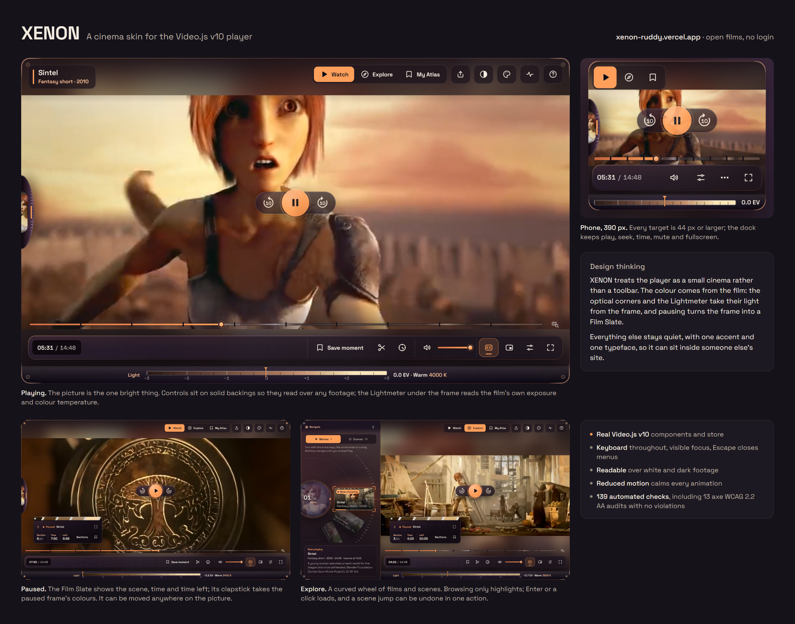

# XENON / Cinema interface

A custom skin for the Video.js v10 player (React, TypeScript, Vite, CSS), built around one idea: **watch a story, explore its scenes, return to your place, remember what mattered.**

**Live:** https://xenon-ruddy.vercel.app/#/ (no login). The player page plays real open films; *Skin only* shows the skin with one video and nothing else.



The submission visual and its four shots live in `submission/`; `submission/visual.html` is the source of the board.

## Design thinking

XENON treats the player as a small cinema rather than a toolbar. The picture is the one bright thing on the page: the Photon Frame's optical corners and the Lightmeter take their light and colour from the film itself, and pausing turns the frame into a Film Slate with the scene, time and time left. Everything else (the controls, the Playback Pod, the curved Movies/Scenes wheel) stays quiet, on solid tinted backings, so it reads over a white sky or a night scene alike. It sits between Default and Neutral in personality: the film-driven colour and the wheel give it a character of its own, while the chrome uses one accent, sentence case and a single typeface (Space Grotesk) so it can sit inside someone else's site. Every control is a real Video.js v10 component or drives its store, works by keyboard with a visible focus ring, is at least 44px on touch, and calms down when reduced motion is on.

## Quick start

```bash
npm install
npm run dev        # http://localhost:5173
npm run typecheck
npm run build
```

Node 20+ (22 LTS recommended).

## What is in here

| Path | What |
| --- | --- |
| `src/skin/` | **The reusable skin.** `CinemaSkin`, keyboard-shortcut dialog, player-health dialog, icons, CSS. Imports nothing from the demo. |
| `src/features/` | Optional slots: `MomentAtlas`. The Movies/Scenes `NavigationWheel` and `NavigationRail` live in `src/skin/wheel/`. |
| `src/data/` | Demo catalog and localStorage stores (moments, resume positions, My List). |
| `src/pages/` | Home (dark teal), Player (skin + all features), Skin-only workbench. |

The skin needs one video and nothing else:

```tsx
import { Video, VideoPlayer } from '@videojs/react/video';
import { CinemaSkin } from './skin';

<VideoPlayer>
  <CinemaSkin title="My film">
    <Video src="/film.mp4" playsInline />
  </CinemaSkin>
</VideoPlayer>
```

`railSlot`, `atlasSlot`, `topActions`, `markers`, `onSaveMoment` and `diagnosticsRows` are optional. Without slots the Watch/Explore/My Atlas switch is not rendered.

## Video.js v10 usage

Official `@videojs/react@10.3.0`: `VideoPlayer` (preset `createPlayer` with `videoFeatures`), `Container`, `Controls`, `TimeSlider`, `VolumeSlider`, `PlayButton`, `SeekButton`, `MuteButton`, `CaptionsButton`, `PiPButton`, `FullscreenButton`, `Menu` with the captions and playback-rate radio groups, `Hotkey`, `Gesture`, `StatusAnnouncer`, `ErrorDialog`, and `usePlayer` / `useMedia`. There is no v8 `videojs()` call anywhere.

## Features implemented

- **Watch / Explore / My Atlas** modes. Switching never restarts playback or changes `currentTime`.
- **Wheel**: Movies and Scenes on one wheel. CSS-positioned arc with a turning tick dial; becomes a snap carousel when the player is narrower than 760px. Arrow keys, Home/End, PageUp/Down browse (the wheel owns those keys while focused); Enter/Space/click selects; mouse wheel and drag turn it. Browsing only highlights.
- **Scenes** are *timed sections*, because none of the bundled films publish chapters. They are labelled "Section n", never as story scenes. If a film's `chapters` array is filled in, real chapter titles are used.
- **Return Anchor** and **Journey Trail** for intentional jumps (scene, saved moment); reset when the film changes.
- **My Atlas**: save the current moment, save "the last 10 s", rename, jump, delete, export/import JSON. Stored per film in `localStorage` (`cinema-skin:v1:*`), validated on read.
- **Resume**: positions saved every 5 s; switching to a film (or reloading it) resumes after metadata loads. Deep link: `#/watch/<id>?t=<seconds>`; the share button copies one.
- **Scrim**: Default / High contrast / Theater, persisted.
- **Keyboard dialog** (`?`) and **Player health** dialog built on native `<dialog>` (focus trap, Escape, focus return). Health shows live player readings with Pass / Needs review / Unavailable, and explicitly does not claim WCAG compliance.
- Buffering, ended/replay, and playback-error states (the error dialog's Close dismisses it).

### Design system, settings control centre and responsive tiers

- **One typeface.** Space Grotesk (variable, self-hosted through `@fontsource-variable/space-grotesk`, SIL OFL, no font request to a third party) is the only branded UI font, with a system-font fallback stack. `src/skin/tokens.css` defines the scale: sizes from 12px up, four weights, slight negative tracking for display titles only (labels are sentence case with no added tracking), a 4px spacing scale, a radius scale, and control heights. Timecodes, offsets and counters use tabular numerals so they never shift. Subtitle typography is separate (Settings → Subtitles → Subtitle appearance: size, typeface, colour, background, position, edge).
- **Settings control centre** (the gear, or the CC and palette buttons): Playback, Subtitles, Appearance, Accessibility and Advanced tabs (arrow keys, Home and End move between them), plus a search box that finds any setting by name or category. Cards appear only when the current video can really offer them (no fake qualities, audio tracks or servers); a single-quality source shows an honest note instead. Advanced holds playback diagnostics, the shortcut guide and a reset for appearance, accessibility and dock settings.
- **Accessibility profiles:** Standard, High contrast, Large controls and Reduced motion, each adjustable afterwards (the profile then reads "Custom"). Saved in `localStorage`. The operating system's reduced-motion setting is also respected. Selected states always carry a check mark or weight as well as a colour.
- **Layout tiers from the player's real container width** (not the window): full (680px and up), compact (440 and up, icon-only dock), tiny (340 and up, secondary actions in a More menu) and micro (under 340: the dock keeps time, mute, More and fullscreen). Play/pause, seek, time, volume or mute, and fullscreen exist at every tier. Panels sit under the video on small players so they never run off screen.
- **Test bench (demo site only, `src/pages/TestBench.tsx`).** Desktop / Tablet / Phone / Tiny presets change the real width of the player's container (no transforms), and a Footage Test selector (Default, Wash to White, Dark Footage, High Contrast Test) places a layer over the video only, beneath captions and controls. Neither control remounts or restarts the video. The reusable skin knows nothing about the bench; it only exposes two generic props, `videoOverlay` and `forceHighContrast`.

### Adaptive Movie Atmosphere (optional, off by default)

Open the palette button in the header. With the switch off the skin looks exactly as before; nothing is applied. Turned on, the surroundings (wheel panel, header, control bar, letterbox areas) pick up the selected film's artwork:

- **Background**: the film's licensed still frame, a solid colour, or your own image (resized to 1280px JPEG and stored in this browser only).
- **Controls**: artwork opacity, blur, ambient light, accent colour (citron, from the artwork, lavender, teal, rose, or a custom hex), text contrast (normal or high), and a Glass / Solid / Clear style for the header buttons, the wheel and side panels, and the control bar.
- **Contrast safety**: colours are read from the artwork in the browser, but never applied blindly. The surface tint is a darkened copy; a readability scrim is sized so body text reaches 4.5:1 (7:1 in High contrast) however bright the artwork or high the opacity; accents are lightened until they reach 4.5:1 against the panels and fall back to the default if they cannot. The studio shows the measured numbers.
- **Presets**: save, apply and delete named presets (they do not include a custom image). Everything is in `localStorage`; no backend.
- **The video is never filtered.** Blur, tint and opacity apply only to background layers behind the layout; the video stage is merely transparent where no video pixels exist.
- Changing film updates the artwork, palette, credit line and title live, no reload.
- If a host blocks pixel access, a safe default palette is used and the studio says so.

The wheel panel also collapses (chevron button, Enter/Space). Collapsed, it is marked `inert` so it leaves the tab order; the choice is remembered. On phones it collapses vertically.

### Settings, subtitles and clips

Floating, non-modal panels (Escape closes, focus returns to the button, outside press closes; on phones they sit under the video):

- **Settings**: cards for Quality, Speed (0.5–2×), Audio, Subtitles, Server, Skip and Download. **A card appears only when its data is real.** Quality lists the separate files a film really has (Commons: 240p, 480p, 1080p; no 4K is offered because no 4K rendition is served) or adaptive renditions when an HLS/Mux source exposes them; changing it reloads the file and returns to the same second. Server shows only when a film has two real hosts (Sintel and Big Buck Bunny: Wikimedia Commons and the Internet Archive). Audio appears only with two or more tracks. Skip buttons need `segments` data (none of the bundled films have any, so none are shown). Download is offered only for films whose licence allows it.
- **Subtitles**: captions are drawn by the skin. Sources: tracks inside the video, uploaded `.srt`/`.vtt` files (parsed in the browser), and pasted text. Per-film storage in `localStorage`. Language names via `Intl.DisplayNames`; a flag emoji only when the code carries a region (for example `pt-BR`). Timing offset ±30 s. Appearance: size, colour, background opacity, position, text edge, with preview. Auto-sync is **not** offered unless the host passes an `autoSync` function backed by a real alignment service; none is bundled.
- **Transcript**: searchable, timestamped list of the active track; Enter or click seeks; follows playback.
- **Clip**: mark start/end (typed `m:ss` or "set to now"), loop it, play it once, copy the times, or copy a share link (`#/watch/<id>?t=<start>&e=<end>`). It marks a range; it does **not** cut or export a video file.
- **Cast** appears only when the browser reports remote playback as available. No Watch Party: there is no synchronised multi-user backend.
- `C` toggles captions (restoring the last track).

## Keyboard

`Space`/`K` play, `←`/`J` and `→`/`L` ±10 s, `X` clear frame (when paused; the pause slate's grip moves it with the arrow keys), `↑`/`↓` volume, `M` mute, `C` captions (when a track exists), `F` fullscreen, `I` picture-in-picture (when supported), `?` shortcuts, `Esc` closes things. In the wheel the arrows browse instead.

## Media and credits

All demo films are open Blender Foundation movies, **CC BY 3.0**, served as VP9 transcodes from Wikimedia Commons (verified reachable with CORS headers at authoring time):

- *Sintel* (2010), *Tears of Steel* (2012), *Big Buck Bunny* (2008).
- Still frames in the wheel, atlas and hero are generated on demand by Commons from the same files. If a frame fails to load, a timecode card is shown instead.

Netflix artwork from the design references is not used anywhere.

### Mux

Sintel's primary source is a Mux asset, played with the official `MuxVideo` component from `@videojs/react` (not Mux Player), so the Video.js v10 skin, hotkeys, wheel and panels all apply to it. The **public** playback ID is in `src/data/catalog.ts` (`SINTEL_MUX_PLAYBACK_ID`) and can be overridden with `VITE_SINTEL_MUX_PLAYBACK_ID`. Playback IDs are not secrets; no Mux API credentials or signing keys are used or needed in the client.

- Settings → Server lists Mux first, then Wikimedia Commons and the Internet Archive, so there are always real fallbacks. Switching server keeps your position.
- Settings → Quality shows the stream's real HLS renditions (Auto and each rendition Mux made), via Video.js' quality feature.
- Mux's auto-generated English captions load as a subtitle track, appear in the Subtitles menu and Transcript, and are drawn by the skin like any other track. Their cues stream in as the video loads, so the transcript fills as you watch.
- The other two films stay on their open-file sources.

## Deploy (Vercel)

1. Push to GitHub.
2. Import the repo in Vercel; framework preset **Vite**; build `npm run build`; output `dist`.
3. No environment variables are needed; the public Mux playback ID is built in (optionally override it with `VITE_SINTEL_MUX_PLAYBACK_ID`).

Hash routing means no rewrite rules are needed.

## Known gaps

Not implemented: audio visualizer (reported as Unavailable in Player health), seek-bar hover thumbnails (Time Lens), watch-footprint ranges, scene threads, automatic subtitle sync (needs a service), Watch Party. Untested with real data: skip segments, audio-track switching, native `<track>` subtitles, adaptive HLS/Mux quality, and Cast, because no bundled film provides them. Not verified: everything at runtime. Specific risks to check first:

1. `npm run typecheck`: prop types for Video.js render-prop components and `MuxVideo`'s `source` were written from the docs, not from compiler feedback.
2. The settings menu (captions + speed) and its popup placement inside fullscreen.
3. Whether the player's `Hotkey` listeners are fully shadowed by the wheel's key handling.
4. Layout at 320px, 390px, 768px; wheel proportions at 1024–1440px.
5. Commons frame thumbnails can return HTTP 429 when generated in bursts.

See `ACCESSIBILITY_CHECKLIST.md` for what still needs automated and manual testing.

## Final refinement (design/xenon-final-refinement)

- **Adaptive Movie Atmosphere** now starts from each film's signature palette (`Film.palette`), so the accent, surfaces, dock, wheel and focus colours change with the film even before artwork is read. Viewer choices in Appearance still win.
- **Navigation Wheel**: frames ride a real circle around a hub lens with a position readout; a fixed viewfinder gate marks what Enter will select. Movies and Scenes are two faces of the same instrument: switching folds one face into the hub and unfolds the other. Phones get a swipe carousel with the same keyboard model.
- **Time Portal**: selecting a scene (or previewing a saved moment) opens a preview with the film's own still, timing and notes. Playback keeps running; **Jump here** seeks and leaves a Return Anchor, **Keep watching** or Esc closes, and focus returns to where it came from.
- **Timeline preview**: hovering the seek bar shows a real still near that second and the scene name. Scene boundaries are drawn as cuts on the bar.
- **My Atlas**: a strip of frames with names, notes, Play and Preview actions, and a runtime map.
- **Skin Studio** (`#/studio`, demo only): live presets, colours, radius, panel opacity and blur, font and control size, player width, and copyable CSS.

## Movable pause console (feature/movable-slate)

The Film Slate can be moved anywhere on the picture:
- **Drag:** use the grip on its title row (mouse, pen or touch). Only the grip moves it, so the slate's buttons stay clickable.
- **Keyboard:** with the grip focused, the arrow keys move it (Shift moves further), and they never reach the player's seek keys. Home, or a double-click on the grip, puts it back in the lower left.
- **Stays clear:** it settles under the top bar and above the dock. If it is dropped on the Playback Pod, it slides to the nearest clear place.
- **Remembered:** the position is saved in localStorage as a proportion of the free area, so it holds across reloads and player sizes.
- **No re-renders while dragging:** the slate moves with a transform; React only renders when you let go.

## Spectral gradients (feature/spectral-gradients)

Every surface is now layered from one four-stop spectrum per film (deep, mid, light accent, highlight):

| Film | Identity | Spectrum |
| --- | --- | --- |
| Big Buck Bunny | Woodland Gold | `#071C17` `#204A37` `#A47835` `#E2D78A` |
| Sintel | Ember Twilight | `#120D1D` `#463057` `#BF5B3F` `#F4B06B` |
| Tears of Steel | Arctic Cyan | `#071420` `#19445C` `#36A4BC` `#C5E6EF` |

- **Recipes, not one gradient** (`src/skin/spectral.css`). Each surface uses the recipe that fits it, so adjacent surfaces share one colour identity at different strengths:
  - **Shell** (the player body): a multi-stop linear field plus two soft radial blooms.
  - **Glaze:** a translucent spectral tint layered over each surface's existing background, so Glass, Solid and Clear and panel transparency still apply and text keeps its dark backing.
  - **Edge:** the thin metallic highlight on the Photon Frame rim and the dock.
  - **Fill:** progress and level fills.
  - **Grain:** a faint brushed-metal texture on hardware surfaces.
- **Where:** the page background (which continues the player's spectrum), the Photon Frame, the navigation wheel and its card, the Playback Pod, the dock, the timeline, the Lightmeter, the Film Slate and scene cards, My Atlas, settings panels, dialogs, menus, tooltips, the Time Lens and the Appearance Studio. The video is never tinted or filtered.
- **Film switching:** the four stops are registered custom properties, so a switch crossfades the player and the page together over 1.2 s without touching playback. With reduced motion the change is immediate.
- **Appearance Studio › Spectral gradients:**
  - **Presets:** Subtle, Cinematic and Vivid.
  - **Palette:** each film's palette, or your own four colours.
  - **Sliders:** gradient intensity, ambient colour, gradient direction, background blur and panel transparency.
  - **Accent:** custom accent colours are in the Accent card.
  - **Saving:** everything is saved in localStorage.
- **Accessibility:** a unit test composites the strongest preset over a fully white frame and checks each film's text stays at 4.5:1 or better. High contrast keeps flat, opaque surfaces. Forced colours keeps the system's. Browsers without CSS colour mixing keep the previous solid surfaces.

## Lightmeter and animated optical corners (feature/lightmeter)

- **Lightmeter.** A slim plate under the picture reads the frame on screen the way a cinematographer's meter would. The picture keeps exactly 16:9; the plate sits below it.
  - **The scale** runs from −3 to +3 stops, painted with the frame's own tones, each placed where its brightness falls.
  - **The needle** is the frame's key: the average brightness against middle grey, in stops (EV).
  - **The reading** adds warm, neutral or cool and the colour temperature in kelvin. It shows "12000+ K" or "2000− K" where the approximation stops being reliable.
  - **Sampling:** it reads a 48×27 copy of the frame every 1.5 s while playing, and once on pause, seek and load. Nothing runs while the tab is hidden.
  - **Unreadable video:** where a host does not allow its pixels to be read (no CORS), it says "No reading" instead of guessing. Wikimedia files are now requested with CORS so they can be read; the archive.org fallback is left as it was.
- **Animated optical corners**, driven by the picture, never by an idle loop:
  - **Light catch:** they take the frame's key light, the lamp's coral in a warm room and steel blue in a blue street, and glide between them.
  - **Glint:** on a cut (a real change of light) one glint runs along each bracket, clockwise round the frame.
  - **Lens iris:** each corner's lens is a small hexagonal iris that opens in dark frames and stops down in bright ones.
  - **Unchanged states:** saving still pulses lavender; high contrast stays white and still.
- **Sizes and preferences:**
  - **Small players:** phone keeps the scale and the exposure; the smallest player and fullscreen drop the plate.
  - **Reduced motion:** no glint and no gliding needle.
  - **Screen readers:** the meter is a labelled image (for example "Light meter: −1.9 EV, warm, 4000 K") that does not announce every reading.

## Photon Frame (feature/photon-frame)

XENON's signature housing: a 1px machined rim on the player's own radius and four **optical corner markers**. Each marker is a bracket that follows the rounded corner, fades along its arms, and has a small lens index inside the curve. It is CSS only (`src/skin/frame/`), aria-hidden, takes no clicks, and nothing animates continuously.

- **Playing:** minimal. Neutral corners, softer still while the controls rest.
- **Paused:** the corners light one after another (a short pause-to-freeze pass) in the film's accent and stay softly lit while the Film Slate appears.
- **Saved moment:** from the dock, the slate or My Atlas, the frame pulses briefly in the Moment Atlas lavender. It is driven by the moment markers, so every way of saving confirms the same way.
- **Exploring:** the seam between the wheel and the picture carries the frame's light. A fine coupler runs from the wheel's gate to it and pulses once for each new selection.
- **Switching films:** the frame's colours are registered custom properties, so they glide to the new film's palette.
- **Fullscreen:** the decoration steps aside.
- **Dock:** the control dock wears the same machined rim. The large outer glow and the thick shell border are gone.
- **Clear Frame:** **X**, or the slate's Clear frame button, puts the optional pause information away for that pause. Focus goes to the pod and every playback control stays reachable; X brings the information back.
- **Smaller players:** corner arms shrink from 46px to 32, 24 and 16px; phone and tiny drop the lens and the light pass.
- **Preferences:** reduced motion lights the corners without animation; high contrast draws the frame plain white; forced colours withdraws it. Focus rings and announcements are unchanged; the frame never stands in for them.

## Film Slate, tail slate, edge lens and the accessibility audit (feature/slate-seek-feedback-endcard)

- **Film Slate (pause).** XENON doesn't dim the picture and lay a synopsis over it. Pausing raises a clapperboard, low on the left. Its chalkboard holds real data: the film, the scene ("Section 3/10"), the timecode and the time left. Its clapstick is painted with the dominant colours of the exact frame you paused on, read from the video frame itself, or from a frame-service still of that second when the video's pixels can't be read; until then it wears the film's palette. It closes with a small clap as it appears. It is under 5% of the frame, takes no focus, and can be put away at once. Neighbouring scenes and Scene Insight, Save moment and the Time Tether are still one press away.
- **Tail slate (end of the film).** At the end of a film the slate comes back the way crews mark the end of a take: held upside down, with the clapstick below. It names the next film on the wheel that you haven't finished, with an explicit **Play**. There is no countdown and no autoplay, but once you press Play the new film starts by itself. "Choose on the wheel" covers everything else; Replay stays on the pod. The end is announced to screen readers.
- **Edge lens.** Seeks from J/L, the arrow keys and double taps rise as a curved glow on the side the film moved towards, reading "−10 s", "+20 s" for quick repeats, or "Start" / "End" when clamped. It is Video.js's own `SeekIndicator`, so it appears exactly when a seek happened and never doubles the pod's own confirmation.
- **Play means play.** Choosing **Play** on the wheel or on the tail slate now starts the new film once it can play.
- **Accessibility audit.** `npm run e2e` injects axe-core and audits ten states against WCAG 2.2 AA: the paused Film Slate, the navigation drawer, Explore expanded and collapsed, My Atlas, Settings, the Time Lens, the shortcuts dialog, the tail slate and the phone sheet. All ten currently report zero violations. The audit found one real issue, now fixed: the wheel's card could scroll with no focusable content, so an overflowing card now becomes a labelled, focusable region.

## Navigation Wheel restored, Precision Playback Pod (fix/wheel-overlap-playback-pod)

- **Drawer overlap fixed.** An open navigation drawer is always the full 380px instrument, whatever the saved collapsed state, and it overlays only the picture's own grid area; it no longer spans grid columns. Explore gives the rail its own column (380px, or a 64px spine when collapsed) and the picture starts where it ends. Small players get a sheet under the picture. All placement lives in one stylesheet, `src/skin/rail.css`.
  *Root cause:* the open width was set with `@container cs (min-width: 761px) { .cs-root[data-drawer='open'] { --cs-rail-w: 380px } }`. A container query only styles descendants of its container, never the container itself (`.cs-root` is the `cs` container), so that rule never applied. A saved `wheel-collapsed` left `--cs-rail-w` at 64px, while another rule forced the drawer body visible and a third let the drawer span `grid-column: 1 / -1`. The wheel, its title and its card were squeezed into 64px under the picture. The rail rules were spread over five stylesheets.
- **The curved Movies/Scenes wheel is back** in place of the Optic: NAVIGATE heading, Movies/Scenes switch, the curved filmstrip of rectangular frames, hub readout, viewfinder gate, turning tick dial and the NOW PLAYING / You are in card. Its motion is now a spring engine that writes CSS custom properties every animation frame. Drag and trackpad scroll follow the pointer, a flick coasts and decelerates, and the wheel snaps to the nearest frame. Frames gain subtle depth, the frame in the gate enlarges and catches the film's light, and Movies/Scenes switching folds one face into the hub. React renders only when a different frame reaches the gate. Under reduced motion, selection is immediate. Nothing plays or seeks until the card's **Play** or **Jump**; Enter on a frame moves focus to that action.
- **XENON Precision Playback Pod.** One capsule: Rewind 10 s | a 64px Play/Pause disc | Forward 10 s. Every part is a real Video.js `SeekButton` / `PlayButton`, so seeking (clamped to the start and end), labels ("Rewind 10 seconds", "Forward 10 seconds", Play/Pause), hotkeys and the status announcer stay Video.js's own; the pod only adds feedback after the original handler runs. Play sends one sweep of light round a hairline ring (no dial) and the icon cross-fades. Pause leaves a restrained outline in the film's colour. A seek nudges the arrow and confirms "−10 s" / "+10 s", or "Start" / "End" when clamped. Its colours come from the film's palette: plum and ember for Sintel, blue and cyan for Tears of Steel, forest green and gold for Big Buck Bunny. It fades while playing and never blocks a click when idle.

## Signature Optical Cinema (design/optical-cinema)

One instrument, three ideas that work together: **look** through the Optic, **leave** a Time Tether behind you, **keep** what matters as a Memory Capsule.

- **XENON Optic** (since replaced by the restored Navigation Wheel, see above) replaced the Movies wheel, the Scenes wheel, the Scene Dial and the Time Portal with a single lens. The outer ring carries the films, the inner ring the scenes of the film that is playing (laid out by real time), and the centre is the lens: a real still of whatever the rings point at, read out below with one action. Turning the films ring never switches films; **Play** does, and an **Optical Iris** closes and opens over the picture as it happens. Both rings are ARIA sliders (arrows, Home/End, Enter), respond to drag, click and scroll, and **Show as list** gives a plain list of the same choices. It appears as a glass column in Explore (the film's blurred light shows through), as a drawer from the reel handle or **W** elsewhere, and as a bottom sheet under the picture on small players.
- **Filmprint timeline.** 24 stills are sampled once per film from the permitted frame service, averaged to colours and cached; the strip carries the film's colour fingerprint and opens up when you explore it. Hover shows the still and the scene; **T** or the lens button opens the full filmstrip (Time Lens). If stills cannot be read, it is a plain timeline. The seek slider underneath is the real Video.js TimeSlider.
- **Time Tether and Journey.** Every exploration remembers where you were: a diamond and a dashed band on the timeline, a diamond on the Optic, and a chip beside the time that takes you back in one action (or **B**). The Journey button replays the session's recent stops; it is history, not bookmarks.
- **Pause Canvas, refined** (since replaced by the Film Slate, see above). One small strip low on the left (under 4% of the frame), with the transport as the clear way back. Scene neighbours and Scene Insight appear only when asked for, the strip dismisses instantly, and captions stay on top.
- **Living Lightfield.** Each film's glow and secondary light drift slowly behind the instrument, alongside its blurred artwork when that is on. Sintel is plum, ember and ivory; Tears of Steel industrial navy, cyan and silver; Big Buck Bunny woodland green, soft gold and warm cream. The video itself is never filtered.
- **Memory Capsules.** Saved moments carry their film (in its colours), scene, time, still and note, for this film or all films; capsules from another film open it explicitly. Storage, export and import are unchanged.
- **XENON Test Lab.** The size and footage tools now sit below the player, folded, and remain demo-page only.

## Cinematic Hardware (design/cinematic-hardware)

XENON is drawn as one instrument rather than a toolbar:

- **Reel handle and wheel drawer.** In Watch mode the edge of a film reel sits at the left of the picture, with a sliver of the current film in its window and a lit index. Click it, or press **W**, and it unrolls into the full Movies/Scenes wheel over the left of the picture; Escape or a click outside closes it and focus returns to the reel. Choosing a film opens a **film preview**; nothing changes until you press **Play**. On phones the wheel is a swipe carousel under the video.
- **Transport.** Now the Precision Playback Pod (see above). It is rendered once: over the picture in Floating, inside the dock in Compact and Expanded.
- **Precision filmstrip timeline.** A real Video.js TimeSlider with one graduation per minute, scene boundaries as cuts, saved moments as lavender bars and the Return Anchor as a diamond. Hovering shows a real still near that second.
- **Time Lens** (**T** or the lens button). The timeline opens into a filmstrip: a magnified still at the target, nine stills across a 2 min / 40 s / 12 s span, timestamps, scene cuts, moments and the playhead. Arrows, drag or the ±1/±5 s buttons aim it; it never seeks until **Jump**, which leaves a Return Anchor. Without thumbnails it still works as a timecode ruler.
- **Precision Scene Dial.** A radial ARIA slider whose graduations sit only where scenes really begin, with the playhead, the Return Anchor, a preview and Jump. A plain **List** view offers the same choices. It is hidden when a video has no scene data.
- **Pause Canvas.** When paused: the title, time, current scene, the previous and next scenes (previews open in the Time Portal), Save moment and the Return Anchor, in the film's colours, beside the frame and under the captions. It takes no focus; Space/K resumes. Turn it off in Appearance › Control dock.
- **Control dock layouts** (Appearance › Control dock): **Floating**, **Compact** (one slim bar, timeline inline) or **Expanded** (a labelled console under the picture that never covers the film). Tools that do not fit move into More; play, seek, time, sound and fullscreen are always reachable.
- **Film-reactive atmosphere.** Sintel is *Ember Fantasy*, Tears of Steel *Cyber Steel*, Big Buck Bunny *Woodland Cinema*. Each palette sets the surfaces, accent, text and a secondary light; the demo page around the player follows too. Appearance offers Adaptive or Fixed theme, custom accent and panel colour, artwork, opacity, blur and ambient light. The video itself is never tinted.

**About scenes.** The bundled films publish no chapters, so the Scenes wheel, Scene Dial, Pause Canvas and Time Lens use equal, plainly labelled *sections* (Section 1, Section 2…). Supply real chapters in `Film.chapters` (title, start, optional description) and they become chapter titles everywhere, with descriptions shown as Scene Insight.

### Real-browser checks

With the dev server running:

```bash
npm run e2e -- http://localhost:5173 ./e2e-shots
```

`scripts/e2e.mjs` drives an installed Chrome or Edge through playwright-core (no browser download): every dock layout at Desktop, Tablet, Phone and Tiny, film switching and theming, the Pause Canvas, the status announcer, the Time Lens, the navigation drawer at every size with a saved collapsed rail, Explore collapsed/expanded/reopened, repeated mode switching, reload with saved preferences, wheel scroll/drag/snap, the Playback Pod (exact ±10 s on the real video, clamping, keyboard, touch, palettes), My Atlas, keyboard focus, Escape and focus return, reduced motion and high contrast.

### Public CSS custom properties

| Property | Purpose |
| --- | --- |
| `--media-accent-color` | Accent for selection, progress and focus |
| `--media-accent-text-color` | Text and icons placed on the accent |
| `--media-border-radius` | Outer radius; inner radii scale from it |
| `--media-font-family` | Typeface (Space Grotesk by default) |
| `--xenon-surface-color` | Base colour every surface is mixed from |
| `--xenon-panel-opacity` | 0 to 1, opacity of panels and the dock |
| `--xenon-panel-blur` | Backdrop blur behind panels |
| `--xenon-control-size` | Minimum control size (never below 44px) |

### Tests

```bash
npm test
```

Vitest + Testing Library (jsdom): the wheel's keyboard, scroll and spring motion, external targets and Movies/Scenes fold, the rail's explicit Play/Jump card, the Playback Pod against a real Video.js store (labels, exact ±10 s, clamping, one seek per Enter/Space), film palettes and contrast, moment storage, layout tiers, and the real Video.js skin (mode switching, status announcer, settings Escape and focus return).

## Unslop pass and playback safety net (polish/unslop)

- **Quiet chrome, one accent.** Labels are sentence case without tracking, 600 is the heaviest weight, coloured glows are gone (neutral shadows and hairlines carry depth), the Playback Pod's disc is solid, and text check marks became one line icon. The picture, Photon Frame, Lightmeter and Film Slate keep the film's colour. Direction from the [unslop](https://github.com/heydamir/unslop) skill by Damir Sokolovsky, CC BY 4.0.
- **Stall guard.** Open hosts sometimes serve a copy that never delivers. If a film should be playing but is stuck (data claimed but nothing buffered for 3 s, or no progress for 10 s), the player moves to the next copy of the same film at the same second and says so: another host first, then the other qualities. The player page, *Skin only* and Skin Studio all use it (`src/pages/stall.ts`, `ResilientVideo.tsx`, `nextVariant` in `src/data/catalog.ts`).
